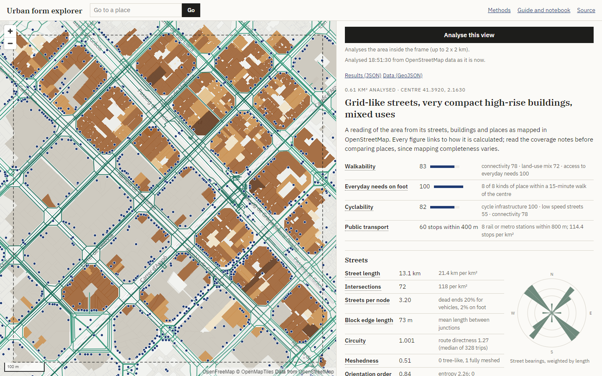
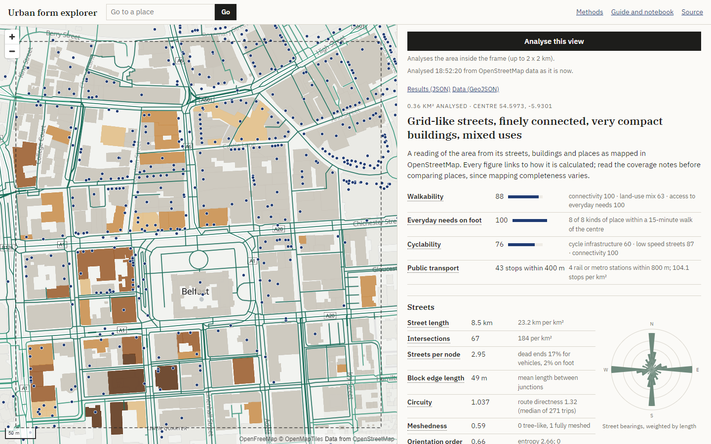
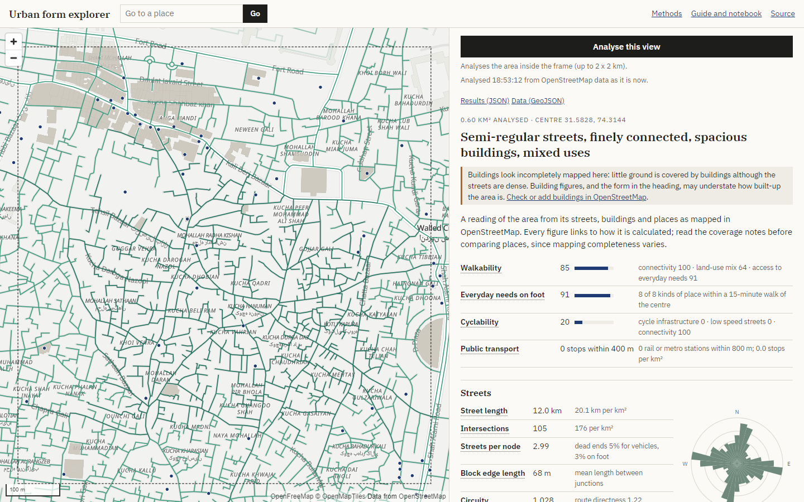

# Urban form explorer

Read the streets, buildings and places of any neighbourhood from OpenStreetMap: <https://ahmadammar.github.io/urban-form-explorer/>

Pan to a place, zoom in, and press **Analyse this view**. The OpenStreetMap data for the area is fetched live from the Overpass API and
measured in the browser:

* **Streets:** length and density, intersections, streets per node, dead ends for vehicles and on foot, block edge length, circuity and
  route directness, meshedness, orientation order with a rose diagram, street widths where tagged.
* **Buildings:** count and density, footprints, heights and floors where tagged, and the Spacematrix measures of density (GSI, FSI, mean
  floors, open space ratio) with a readable label.
* **Places and access:** the mix of uses, walking distance along streets to the nearest place of each everyday kind, and a 15-minute count.
* **Indices:** walkability, everyday needs on foot, cyclability and public transport, each shown with the parts that make it up.

Every figure links to its definition, formula and assumptions on the [methods page](methods.html), and each analysis says how much of the area
has the tags it relies on. The [guide and notebook](https://ahmadammar.github.io/teaching/urban-form/) teach the same measures step by step
with OSMnx, NetworkX and momepy.

| Central Belfast | Lahore's Walled City |
|---|---|
|  |  |

## How it works

No server and no build step: a static page on GitHub Pages.

| File | What it does |
|---|---|
| `src/metrics.js` | Every measure, as pure functions (no browser code) |
| `src/overpass.js` | The Overpass query, with retries across public servers, and parsing into a local metric projection |
| `src/app.js` | The map (MapLibre with OpenFreeMap tiles), the analysis and the report |
| `src/charts.js` | Small SVG charts |
| `methods.html` | Definitions, formulas, assumptions and references |
| `test/metrics.test.mjs` | Tests against known answers: a perfect grid, a circle, Manhattan distances, a square building, tag parsing |

Run locally with any static server, for example `python -m http.server`, and open <http://localhost:8000>. Run the tests with
`node --test test/metrics.test.mjs`. Every push runs the tests before publishing.

## Data and limits

Map data &copy; OpenStreetMap contributors, under the Open Database Licence. Mapping completeness varies between and within cities, above
all for buildings, heights, widths and speed limits; the report states the coverage of each. OpenStreetMap holds no population counts.
Composite indices are indicative and always shown with their parts.

## Licence

Code under the MIT licence (`LICENSE`).
